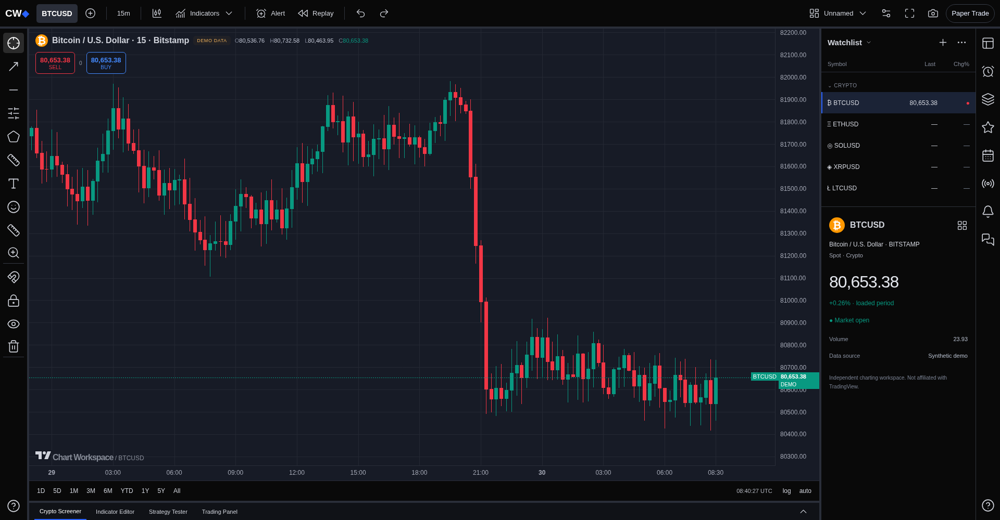
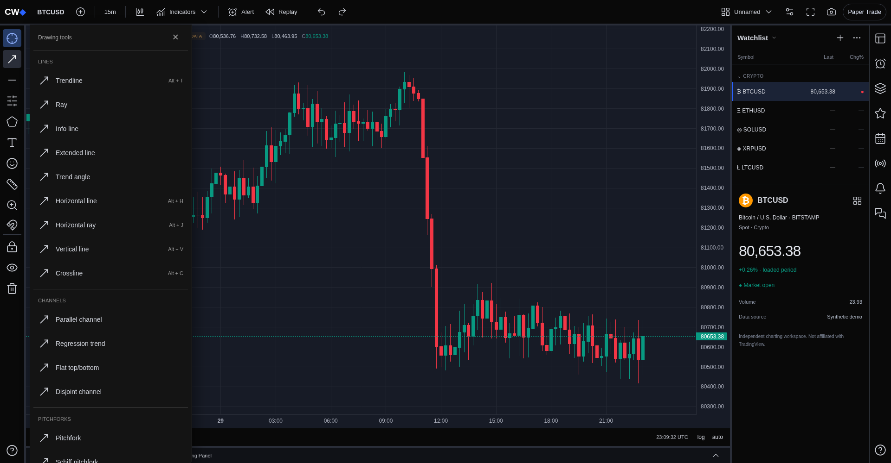
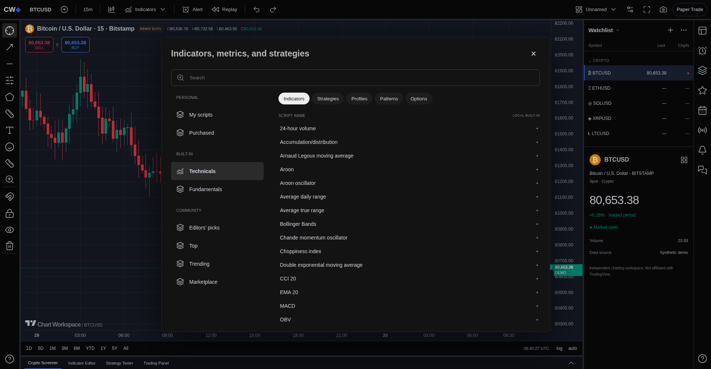
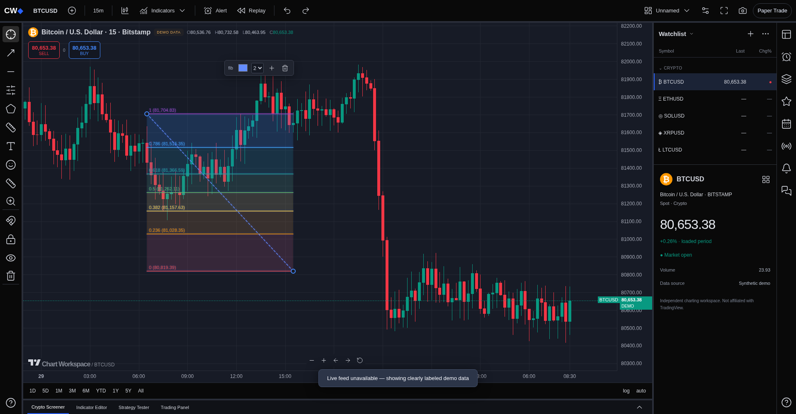
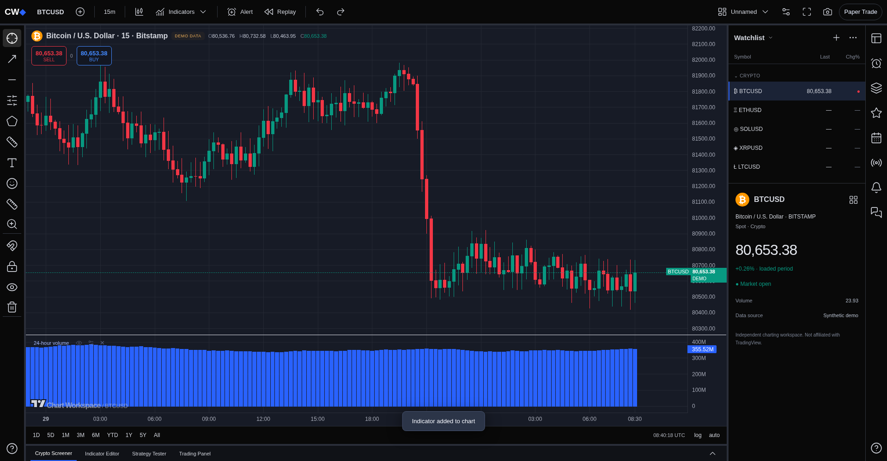

# Chart Workspace

An independent TradingView-inspired web chart workspace built from the supplied screenshot. Not affiliated with TradingView. This is a working subset, **not a full TradingView clone**.

## Run

Node.js 22+ and npm are required.

```sh
npm ci
npm run dev -- --port 5173
```

Production build: `npm run build`. Serve and validate it with `npm run preview`. Deploy behind a server that proxies `/api/ohlc/:symbol` to Bitstamp's `/api/v2/ohlc/:symbol/`; a static-only host needs that route separately. Vite development and preview already provide the route and respect `HTTPS_PROXY`.

## Implemented

- Clean full-height candle chart by default, matching the newer screenshots. Optional indicators create lower panes only when selected.
- Eleven chart types: Bars, Candles, Hollow candles, Line, Line with markers, Step line, Area, Baseline, Columns, High-low and Heikin Ashi. High-low omits open/close information; Heikin Ashi uses synthetic OHLC values.
- BTC, ETH, SOL, XRP and LTC USD markets; 1m through 3D timeframes. Public Bitstamp OHLC refreshes every 30 seconds. Feed failure is visibly labeled; deterministic synthetic candles support offline development. No simulated values are labeled live.
- Twenty-two computed indicators: 24-hour volume, Accumulation/distribution, ALMA, Aroon, Aroon oscillator, Average daily range, ATR, Bollinger Bands, CCI, CMO, Choppiness Index, DEMA, EMA, MACD, OBV, ROC, RSI, SMA, Stochastic, Volume, VWAP and Williams %R. Searchable indicator browser with category navigation, added-state labels and explicit unavailable sections. ADR requires at least 14 daily groups; short histories may produce no values. VWAP is cumulative over loaded candles. Initial EMA/MACD values use first-close seeding; exact TradingView results are not guaranteed.
- Floating drawing menus for Lines, Channels, Pitchforks, Fibonacci and Gann. Rays, extended lines, verticals, crosslines, info/angle lines, regression channels, parallel/disjoint channels, pitchforks, fib extensions/time zones/fans/arcs/circles/spiral and Gann grids/fans; plus rectangle, text, marker and measurement. Tools use one, two, three or four clicks. Alt+T/H/J/V/C/F selects common drawing tools. Escape closes menus and exits drawing mode.
- Undo/redo, candle snapping, hide, lock, object tree and delete. Drawings are stored in logical candle coordinates, so changing intervals/markets resets them. Fibonacci, Gann, angle and channel geometries are independent screen-space implementations, not exact replicas of proprietary tools. Gann square tools are viewport-square constructions, not calibrated price/time ratios. Selected shapes have draggable anchor handles, body dragging, color/thickness controls, duplication, deletion, and undo/redo.
- Local layout save, notes, price-above alerts while page is open, historical candle replay, local paper orders. No money or real exchange orders involved.
- Dark top/left/right/bottom toolbars and watchlist; narrower-screen layout.

## Limits

This does not include the entire TradingView tool/indicator catalog, Pine Script, brokerage integration, tick streaming, a backtesting engine, fundamental/economic feeds, multi-symbol comparison. Those controls explain their limitations rather than pretending to perform unavailable operations. Alerts are polling-based, not a background service. Screenshots export the chart canvas, excluding SVG drawings. Only the selected market has a quote in the watchlist. Historical ranges are bounded to the loaded 400 candles. Local storage is browser-specific; no account or backend persistence exists.

The proprietary TradingView charting implementation has not been extracted. Lightweight Charts is the Apache-2.0 open-source rendering engine; its required attribution link remains visible. Icons use Lucide (ISC).

## Validation

```sh
npm test
npm run build
# Uses installed Chromium by default; override CHROMIUM_PATH when needed.
npx playwright test
```

Tests cover indicator invariants, OHLC integrity, Heikin Ashi recurrence, all menu drawing geometries, all 22 indicator executions, all 11 chart types, menu search/categories, multi-point placement, keyboard shortcuts, paper ordering and responsive layout. Browser tests mock unavailable live data; they do not prove connectivity to Bitstamp.

See `RESEARCH.md` for observed research boundaries and architecture.

## Updated reference screens

The default chart, drawing menus and indicator browser follow the supplied reference images. Community catalogs, fundamentals, automated drawing indicators, order-flow chart types and Pine execution remain unavailable and are labeled accordingly.





## Video interaction update

The uploaded 73-second recording is used as a behavioral reference, in addition to the screenshots. Drawing tools preview the next anchor, finish back in crosshair mode, and expose a floating edit toolbar. Fib retracement shades bounded level bands and labels ratios/prices. Text/note and position projection menus are available. Risk/reward boxes require entry, target and stop anchors; they do not submit orders.

The indicator picker stays open when adding studies. Each lower pane has a visibility, settings and remove control. Settings support color, length for SMA/EMA/RSI/Bollinger, and quote/base currency units for 24-hour volume. Default 24-hour volume sums close × base volume, matching the recording's dollar-volume convention approximately; it is not exact trade-level quote volume. Panes can be resized using the chart separator. The selected timeframe is picked from an anchored menu. Tick/second data and unconnected fundamentals remain unavailable.

Screenshots of the updated interactions:



